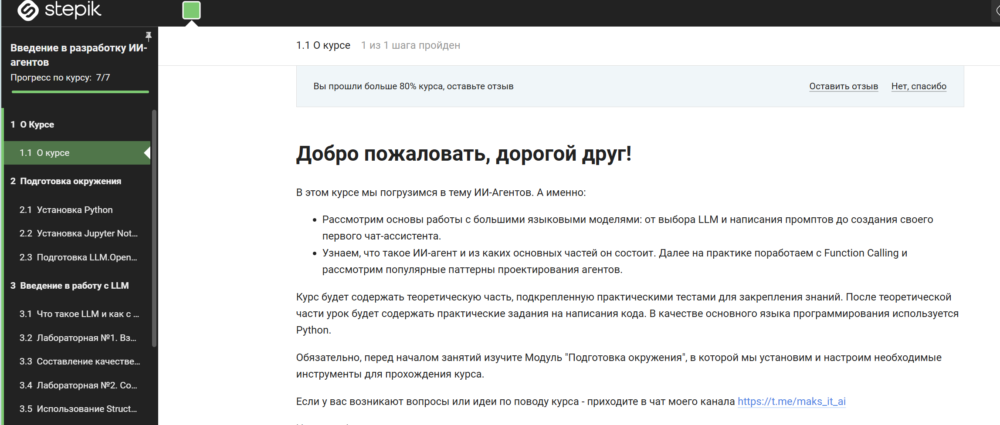

# AI Agents and LLM Self-Study

My self-study work on LLM applications and AI agents (August–September 2026): solutions to the practical assignments of an online course, study notes, and a first language model written from scratch.

## 1. AI agents course

Completed course **"Introduction to AI Agent Development"** (*Введение в разработку ИИ-агентов*) on [Stepik](https://stepik.org): working with LLMs, prompt engineering, structured output, what an agent is, function calling and agent design patterns.



All assignments were done with **local open-source models served by [Ollama](https://ollama.com)** (Gemma 3 4B, Qwen3 4B / 8B) through the OpenAI-compatible API, so no paid API keys were needed.

| Notebook | Topic | Tools |
|---|---|---|
| [`1_1`](ai-agents/solutions/1_1.ipynb) | Talking to an LLM through the OpenAI SDK | OpenAI SDK, Ollama |
| [`1_2`](ai-agents/solutions/1_2.ipynb) | Prompt engineering practice | OpenAI SDK |
| [`1_3`](ai-agents/solutions/1_3.ipynb) | Structured output: extracting typed data, `Literal` choices with reasoning | Pydantic |
| [`2_1`](ai-agents/solutions/2_1.ipynb) | What an AI agent is: a ReAct agent with tools, building my own agent | LangGraph, LangChain |
| [`2_2`](ai-agents/solutions/2_2.ipynb) | Function calling step by step, then with a framework | OpenAI SDK, Pydantic, smolagents |
| [`2_3`](ai-agents/solutions/2_3.ipynb) | Agent architectures on LangGraph: state, nodes, edges, patterns | LangGraph |

Only my own solutions are published; the course's original notebooks belong to its author.

### Notes

- [`mock_interview_answers.md`](ai-agents/notes/mock_interview_answers.md): mock-interview questions on AI agents with model answers and follow-ups, written while preparing for interviews.
- [`transformers_notes.ipynb`](ai-agents/notes/transformers_notes.ipynb): notes on the Hugging Face `transformers` library.

## 2. Language model from scratch

[`llm-from-scratch/`](llm-from-scratch): a **character-level bigram language model** in PyTorch trained on the Tiny Shakespeare corpus (`input.txt`, ~1 MB), as the first step towards a GPT-style model.

- Character vocabulary and encoding, train / validation split, random batches of context windows (`block_size = 8`).
- `nn.Embedding`-based bigram model with cross-entropy loss, trained with AdamW for 3,000 steps.
- Result: loss drops from **4.73** at step 0 to **train 2.46 / validation 2.49** after training (65-character vocabulary), then text is generated by sampling.

| File | Content |
|---|---|
| `bigram.py` | Complete training and generation script |
| `bigram.ipynb` | The same model in a notebook with the training log |
| `language_model_experiments.ipynb` | Step-by-step exploration: data preparation, batching, the model |

```bash
pip install torch
python llm-from-scratch/bigram.py
```

## Tech stack

Python · OpenAI SDK · Ollama · Pydantic · LangChain · LangGraph · smolagents · PyTorch · Hugging Face Transformers

## License

Code: [MIT](LICENSE). Tiny Shakespeare is a public-domain text.
